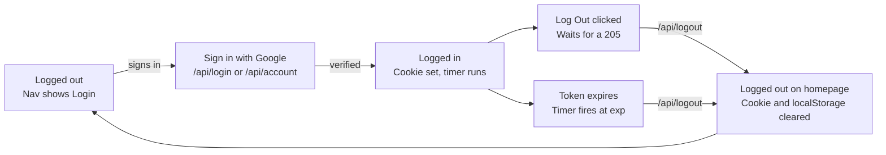

# Spec: sessions

Source: [app/api/session/session.tsx](../../app/api/session/session.tsx), [app/contexts/session.tsx](../../app/contexts/session.tsx), [app/template.tsx](../../app/template.tsx)
Tests: [__tests__/contexts/sessionExpiry.js](../../__tests__/contexts/sessionExpiry.js)

Living copy: [Session behavior spec](https://claude.ai/artifact/QuANrUzKfr954t6pP8DhPJ) (Claude Doc, 2026-10-25).

## Overview

A session starts when Google confirms who the user is and ends when the user logs out or the token expires, whichever comes first. The server owns the session through a signed, httpOnly `session` cookie; the browser only keeps display data and an expiry timer.

Both logout paths call `/api/logout`, clear localStorage, switch the nav to Login and send the user to the homepage.

| Piece | File | Role |
| --- | --- | --- |
| Token and cookie helpers | `app/api/session/session.tsx` | `encrypt`, `decrypt`, `createSession`, `removeSession` |
| Sign in | `app/api/login/route.ts` | Verifies Google token, sets cookie |
| Create account | `app/api/account/route.ts` | Creates user, sets cookie |
| Log out | `app/api/logout/route.ts` | Expires the cookie |
| Protected API | `app/api/league/route.ts` | Checks the cookie before any work |
| Page shell | `app/template.tsx` | Verifies the cookie on each render |
| Client state | `app/contexts/session.tsx` | Login state and the expiry timer |

## Login and account creation

A user signs in or signs up only with Google. Both flows send the Google ID token to the server, which verifies it and, on success, sets the session cookie and returns the user's details.

1. The Google button (`GoogleButton`) loads once the Google SDK script has loaded, and posts `{ token: <Google credential> }` to its endpoint.
2. The server verifies the token with `OAuth2Client.verifyIdToken`, using `GOOGLE_LOGIN_CLIENT_ID` as the audience.
3. On success, the server calls `createSession` and returns `{ email, name: { firstName, lastName }, googleUserId, userId, sessionExpiresAt }`, where `sessionExpiresAt` is the Google token's `exp` in Unix seconds.
4. The client writes `userName` and `googleUserId` to localStorage, sets the session context to logged in with `sessionExpiresAt`, and redirects to `/`.

| Endpoint | Purpose | Success | Errors |
| --- | --- | --- | --- |
| `POST /api/login` | Sign in an existing user | 200 + user details, session cookie set | 401 Google token invalid; 404 no account for this Google user |
| `POST /api/account` | Create an account, then sign in | 200 + user details, session cookie set | 400 token missing or not base64url characters; 401 Google token invalid; 409 account already exists; 502 Google returned no payload |

On the login page, a 404 shows "There was no account found. Try creating one." and a 401 shows "There was an issue logging in. Please try again." On the create account page, a 409 shows "There was an issue creating an account. Try logging in instead." A new account gets a random UUID as its `userId`, stored with the `googleUserId`.

## Session token and cookie

The session is a signed JWT in an httpOnly cookie named `session`, and it expires at the same moment as the Google ID token that created it (about one hour after sign in). A session must never last longer than that token's hour, and there is no refresh: when it ends, the user signs in again.

- **Signing:** `encrypt` signs with HS256 using `SESSION_SECRET`. If the secret is unset, it throws and no session is created.
- **Claims:** `sub` is the app's `userId` (not the Google id), `iat` and `exp` are copied from the Google token. The body's `envelope` is used as the base payload, but no client sends one today.
- **Cookie attributes:**

| Attribute | Value |
| --- | --- |
| Name | `session` |
| `httpOnly` | true, so client code can never read the token |
| `secure` | true in production only |
| `sameSite` | `strict` |
| `path` | `/` |
| `maxAge` | `exp - iat` seconds, so the browser drops the cookie when the token expires |

The client never sees the token. It learns the expiry only from `sessionExpiresAt` in the login response, or from the server on page load (see Client session state).

## Server-side verification

Every protected route must decide who the user is from the `session` cookie alone, never from anything the client sends in the body or from localStorage.

A protected route (today `POST` and `PUT /api/league`) runs these checks in order and stops at the first failure:

1. **Cookie present and well formed.** If there is no `session` cookie, or its raw value does not split on `.` into exactly 3 parts (header.payload.signature), return 401 with `unauthenticatedErrorMessage`. This cheap check runs before any crypto.
2. **Signature and expiry.** `decrypt` calls `jwtVerify` with HS256 and the session secret. A bad signature, a tampered payload, or a token past `exp` fails.
3. **Subject.** If the verified payload has no `sub`, return 401. Otherwise `sub` is the `userId` for the request.
4. **Authorization.** Only then check what that user may do: creating a league requires the `showAdmin` role (else 403), and updating one requires being its `createdBy` (else 403).

The page template (`app/template.tsx`) runs step 2 on every render. A cookie that fails verification is treated as no session: the user renders as logged out.

## Client session state

The server's verified cookie is the source of truth for whether a user is logged in; localStorage only holds display data and must never make a user look logged in on its own.

- **On page load:** the template passes the verified token's `exp` (or `null` when there is no valid session) to `SessionProvider`. The context starts as `isLoggedIn: sessionExpiresAt !== null`.
- **Stale data:** when `sessionExpiresAt` is `null`, the provider clears localStorage, so leftovers from an expired session are dropped.
- **Display data:** `SessionContextedLabel` fills `userName` and `googleUserId` from localStorage only while logged in. When logged out it shows nothing.
- **After login:** the login or create account handler sets `isLoggedIn: true` and `sessionExpiresAt` from the response, so the expiry timer starts without a reload.
- **Navigation:** the nav shows a Login link when `isLoggedIn` is false and the Log Out button when it is true.

| Context field | Type | Meaning |
| --- | --- | --- |
| `isLoggedIn` | boolean | The user has a session the server accepted |
| `userName` | string or null | First name from Google, for display |
| `googleUserId` | string or null | Google `sub`, for display |
| `sessionExpiresAt` | number or null | Token expiry in Unix seconds |

## Logout

Logging out, whether the user clicks Log Out or the token expires, must end in the same state: cookie cleared, localStorage cleared, nav showing Login, and the user on the homepage.

### Manual logout

1. The user clicks Log Out in the nav.
2. The client posts to `/api/logout`.
3. The server calls `removeSession`, which re-sets the `session` cookie with `maxAge: 0` and the same attributes, and responds 205 with no body. With no cookie in the request, it logs a warning and still responds 205.
4. Only on a 205 does the client clear localStorage, set the context to logged out, close the nav menu and redirect to `/`. Any other status logs a warning and the user stays logged in on the client.

### Automatic logout on expiry

1. While `isLoggedIn` is true and `sessionExpiresAt` is set, `SessionProvider` schedules a timer for `sessionExpiresAt × 1000 − now` ms (0 if already past). There is no allowance for clock skew: the timer fires exactly at `exp` by the browser's clock, never early or late on purpose.
2. When it fires, the client posts to `/api/logout` and waits for the response. If the request fails (a network error), it only logs a warning and the user stays logged in on the client.
3. Once the request succeeds, with any response status, it clears localStorage, sets the context to logged out with `sessionExpiresAt: null`, which switches the nav to Login, and redirects to `/` (the homepage, not the login page). The homepage then shows a message telling the user their session expired (planned for a follow-up PR).
4. The timer is cancelled and rescheduled whenever `isLoggedIn` or `sessionExpiresAt` changes, so a new login starts a fresh timer.

If the tab was closed or asleep at expiry, the next page load covers it: the browser has dropped the cookie (`maxAge`), or the server rejects the expired token, and the user renders as logged out with localStorage cleared. API calls made after expiry get a 401 from step 2 of server-side verification.

### Logout across tabs

When any tab logs out, by Log Out or by expiry, every other open tab of the app must log out too.

1. The tab that logs out tells the other tabs, for example with a `BroadcastChannel` message or the `storage` event that clearing localStorage fires.
2. Each other tab sets its context to logged out with `sessionExpiresAt: null`, switches the nav to Login and redirects to `/`.
3. Other tabs do not call `/api/logout` again, since the cookie is shared and already cleared.

This is not built yet: today each tab waits for its own expiry timer or its next page load.

## Gaps in the current code

The code mostly matches this spec; these are the places it still falls short.

- **`decrypt` returns a response on failure.** It returns a 401 `NextResponse` instead of `null`, and callers only work because that object has no `sub` or `exp`. It should return `null` and let each caller respond.
- **`/api/login` has no reply when Google returns no payload.** `/api/account` answers 502 in that case; login should too.
- **Manual and automatic logout check the response differently.** The Log Out button needs a 205, while expiry accepts any response from `/api/logout`. Since the cookie is httpOnly, the client cannot tell if it was cleared either way.
- **A failed logout at expiry is not retried.** The timer does not reschedule, so after a network error the user still looks logged in until the next page load, even though their API calls already get 401s.
- **Manual logout leaves `sessionExpiresAt` set.** It is harmless because `isLoggedIn` is false, but it should be `null` to match the expiry path.
- **`/api/logout` does not await `removeSession`.** It works only because `removeSession` has no awaits inside.

## To do

- [ ] **Follow-up PR: session expired message.** After an automatic logout, show a message on the homepage telling the user their session expired.
- [ ] **Logout across tabs.** When one tab logs out or expires, log out every other open tab (see Logout across tabs).
- [ ] **Fix the gaps above.** Each item in Gaps in the current code.
